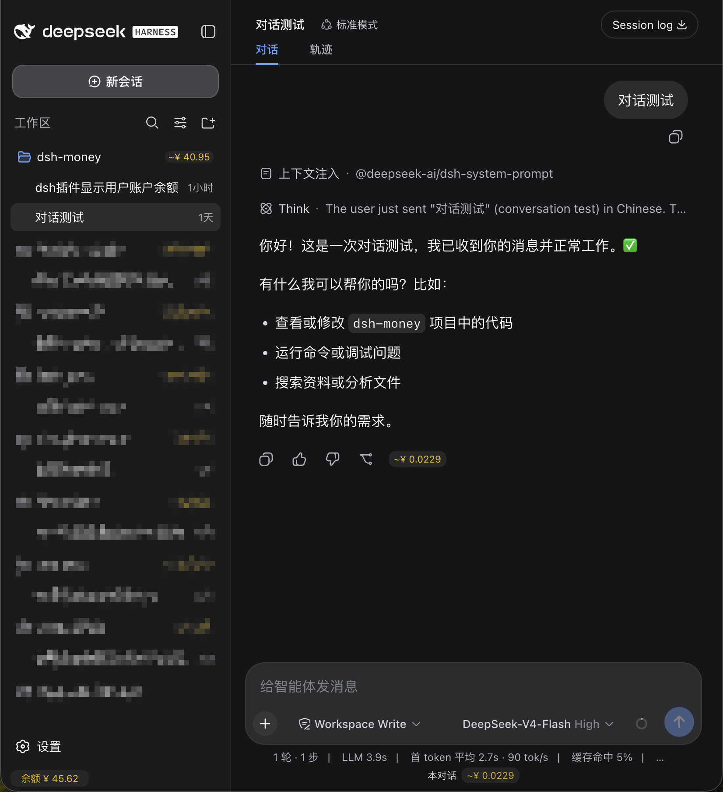
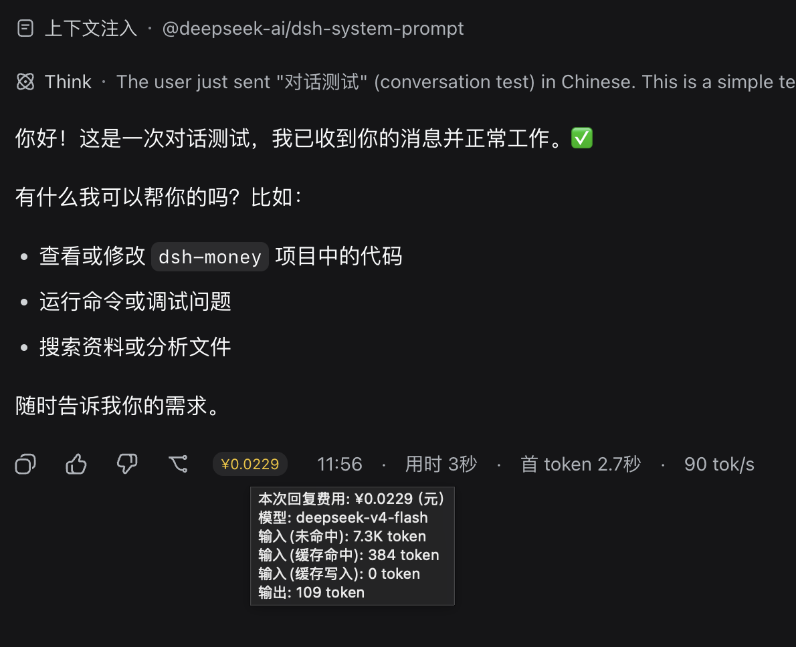
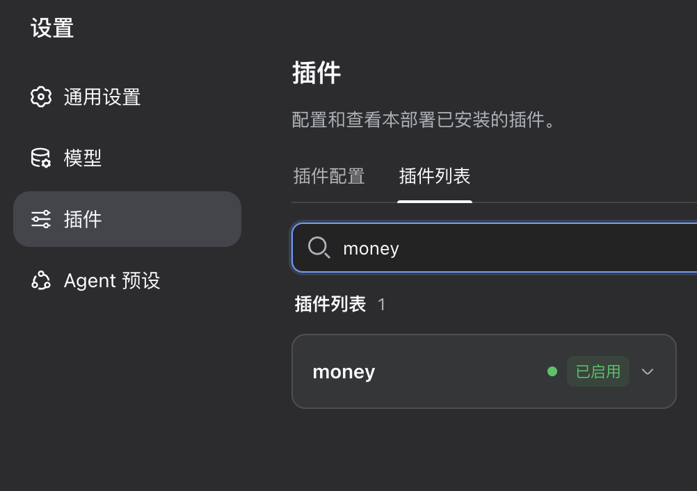
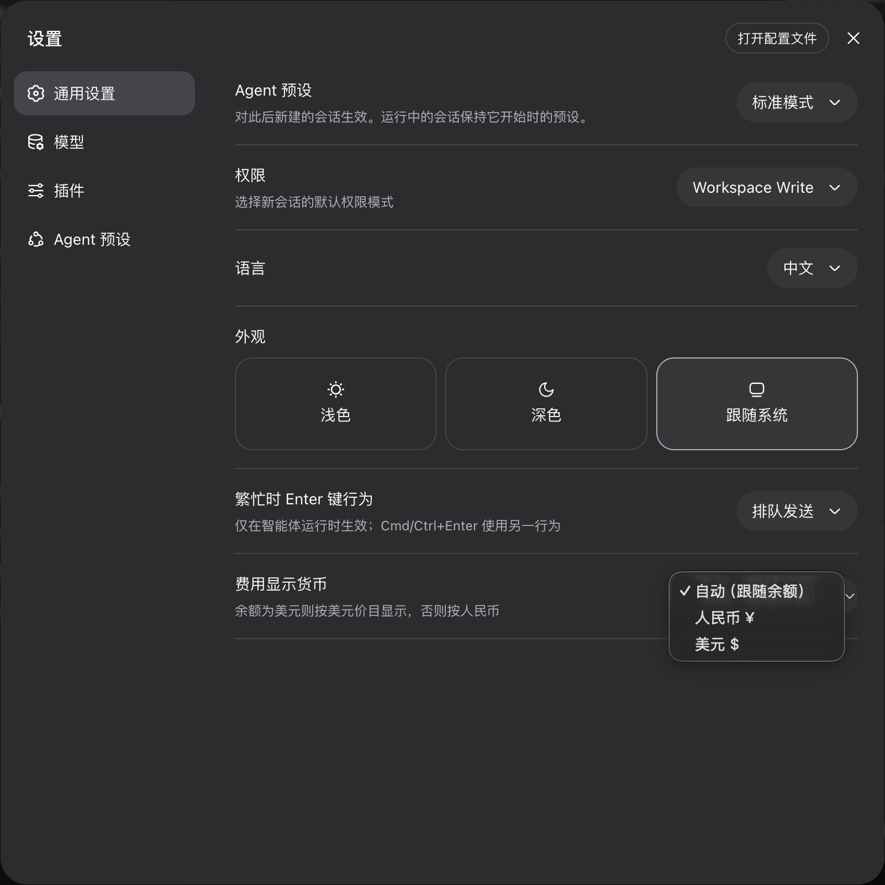
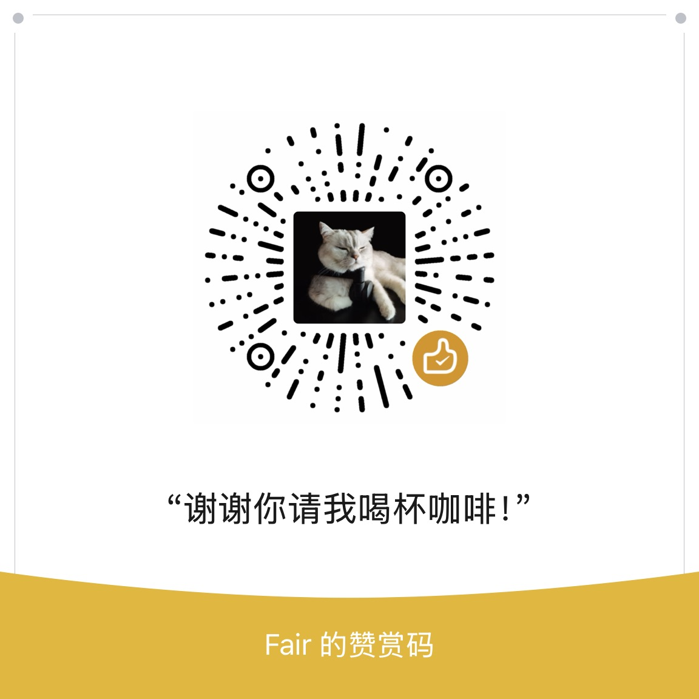

# dsh-money
> DeepSeek Harness 费用追踪插件 —— 实时显示账号余额、当前对话费用与每次回复费用，全部金额以金色（`#f0c11d`）标签（徽章）风格展示，估算费用带 `~` 符号。

    

显示 DeepSeek Harness 账号余额、当前对话费用与每次回复费用：



鼠标悬停能显示详细信息：



插件形式加载（Plugins 页面可启用/停用）：



设置货币类型：



> 截图取自 1.1.x，界面位置在 1.2.0 起有调整：余额移到「设置按钮旁」（`sidebar.footer.action`），每条回复费用标签在操作按钮行内。1.3.x 又增加了余额右侧的高峰/闲时徽章、输入框下方只保留合计徽章、悬停改为自绘浮层。

## 兼容性

| dsh-money | DeepSeek Harness |
|---|---|
| **1.3.x** | **0.2.x**（当前适配 `0.2.1-rc.5`，`engines.dsh: ^0.2.1-rc.5`） |
| 1.2.x | 0.2.x（基础适配） |
| ≤ 1.1.9 | 0.1.x |

`1.3.5` 为 npm 包补充 `packages/dsh-money/README.md`（npm 页面此前没有说明），同时修订本文档里过时的界面/悬停描述。

`1.3.4` 精简输入框下方：只保留「本对话」合计徽章，高峰/闲时不再作为独立徽章展示（悬停明细仍给出分项与条数）。

`1.3.3` 时段悬停显示详细时间：`高峰/闲时` 徽章的明细给出「本次时段：MM-DD（周X）HH:MM 起」与「下次切换：MM-DD（周X）HH:MM 起为…」，跨周末/节假日也不会只看时分；本对话的高峰/闲时分项悬停同时显示当前时段区间。

`1.3.2` 修复悬停提示不显示：DSH 桌面窗口不渲染原生 `title` 提示，改为自绘浮层（多行明细、跟随鼠标、贴近视口边缘时自动翻转）。

`1.3.1` 起，悬停明细也给出分项：本对话徽章悬停显示总额 + 高峰/闲时合计（含条数），工作区徽章悬停显示总额 + 高峰/闲时合计 + 会话数。

`1.3.0` 新增高峰/闲时区分：

- 高峰判定**完全按官方口径**：北京时间周一至周五 9:00-12:00、14:00-18:00，**排除中国法定节假日**（内置 2026 年国务院放假安排；周末含调休上班日一律闲时）
- 余额右侧新增**时段徽章**（`高峰` / `闲时`），悬停显示规则与下次切换时间；到切换点自动刷新
- 「本对话」悬停明细给出高峰 / 闲时分别合计（含条数）；行内只显示合计徽章，不额外占位
- 每条回复的费用悬停明细新增 `计价时段: 高峰（单价 ×2）/ 闲时`

`1.2.0` 是针对 DSH 0.2.x 的适配版本，主要变化：

- 安装方式改为**标准 bundle**（包内自带 `cordis.patch.yml`），`dsh plugin add` / Plugins 页面安装即挂载，不再需要手写 profile 补丁行
- 余额改走 DSH 0.2.x 的 `ctx.deepseekAccount`（登录账号）服务，API Key 作为兜底；不再依赖已移除的 `settings.get()` / `shell.run()`
- 计价表更新为 **2026-11 官方价目**，模型名改为 `deepseek-flash`（旧名 `deepseek-v4-flash` 仍按 Flash 计费）
- 高峰时段改为**北京时间周一至周五** 9:00-12:00、14:00-18:00（周末为低谷）
- 侧边栏余额改用官方 `sidebar.footer.action` 槽位；工作区徽章改用 0.2.x 的 `data-row-key` 行标识（0.2.x 已移除 `data-slot` 属性）
- typert 产物用 0.2.1 生成器重新生成（旧产物会在启动时报 `result codec has no create() factory`）

## 功能

| 显示项 | 说明 |
|---|---|
| **账号剩余金额** | 登录账号优先读取 Platform 余额（充值 + 赠送钱包合计）；未登录时回退到 `DEEPSEEK_API_KEY` 的 `GET /user/balance`。60 秒缓存自动刷新，显示在侧边栏底部（设置按钮旁） |
| **当前时段** | 余额右侧的 `高峰` / `闲时` 徽章，按官方规则（工作日 9-12、14-18，法定节假日除外）实时判断，到切换点自动更新 |
| **当前对话费用** | 折叠会话日志中每条 `assistant/message` 的 token 用量，按官方价目表实时计价并求和，并分列高峰 / 闲时合计 |
| **每次回复费用** | 逐条回复独立计价（该条所在时段决定是否 ×2），以金色标签显示在该条回复的操作按钮行内 |
| **工作区总费用** | 侧边栏每个工作区行显示其全部会话的费用总和 |

### 界面

- **侧边栏底部余额**：`余额 [¥ 110.00]`，位于设置按钮旁（`sidebar.footer.action`），金色徽章样式，60 秒自动刷新；侧边栏折叠为图标栏时只显示币种符号
- **余额右侧时段徽章**：`高峰`（橙色）或 `闲时`（绿色）；悬停显示判定规则、本次时段起点与下次切换的完整日期时间（`MM-DD（周X）HH:MM`），到切换点自动刷新。侧边栏折叠时不显示
- **侧边栏工作区行**：每个工作区行右侧显示其总费用（如 `~¥ 8.72`），悬停显示会话数与估算说明
- **输入框下方统计行**（`conversation.composer.dock`）：`本对话 [~¥ 8.7188]`，行内只显示合计；悬停后展开高峰 / 闲时分别合计（含条数），30 秒自动刷新
- **每条回复费用标签**（`conversation.chat.assistant-actions`）：位于该条回复操作按钮行内，悬停显示模型、计价时段（高峰 ×2 / 闲时）与 token 明细（输入未命中 / 缓存命中 / 缓存写入 / 输出，全部带 `token` 单位）
- **设置页 → General**：可切换显示币种（自动跟随余额 / 人民币 ¥ / 美元 $）

### 显示约定

- **金色**：所有金钱文字统一金色 `#f0c11d`，圆角徽章（标签）风格
- **估算符号**：费用基于官方公开价目 × token 用量估算，统一加 `~` 前缀（如 `~¥ 0.0045`）；余额来自账号/API 为实际值，不加
- **¥ 空格**：人民币符号 `¥` 与数字之间带空格（如 `¥ 110.00`）；美元 `$` 不带
- **单位标注**：token 数量统一带单位（`1.2K token`、`328 token`）；悬停明细中的费用行注明 `（元，估算）` / `（美元，估算）`

### 计价口径

基于 [DeepSeek 官方价格页](https://api-docs.deepseek.com/zh-cn/quick_start/pricing)（**更新日期：2026-11**，高峰价 = 空闲价 × 2）：

| 模型 | 币种 | 缓存命中（空闲） | 未命中（空闲） | 输出（空闲） |
|---|---|---|---|---|
| deepseek-flash | ¥ / $ | 0.02 / 0.003 | 1 / 0.15 | 4 / 0.6 |
| deepseek-v4-pro | ¥ / $ | 0.15 / 0.022 | 4.5 / 0.66 | 13.5 / 1.98 |

> **价格来源**：[DeepSeek 官方价格页](https://api-docs.deepseek.com/zh-cn/quick_start/pricing)（中文）/ [Pricing 英文页](https://api-docs.deepseek.com/quick_start/pricing)。
>
> **更新日期**：2026-11（价格表在 `packages/dsh-money/src/index.ts` 的 `PRICES` 常量中，官方调价时需同步更新并升级版本）。
>
> **模型别名**：官方说明旧模型名 `deepseek-v4-flash`、`deepseek-v4-flash-vision-exp` 仍可调用但按 Flash 价格计费，插件对这两个名字按 `deepseek-flash` 计价；**不在价目表中的模型（例如本地 Ollama 模型）不显示费用**，不会套用 DeepSeek 价格。
>
> 单位：每百万 token。高峰时段 = 北京时间**周一至周五** 9:00-12:00、14:00-18:00（即 UTC 01:00-04:00、06:00-10:00），价格翻倍；周末全天为低谷。
>
> **法定节假日**：按官方口径，中国法定节假日全天为闲时（含落在工作日的假期），调休上班的周末仍按周末算闲时。插件内置 2026 年放假安排（[国办发明电〔2025〕7号](https://www.gov.cn/zhengce/content/202511/content_7047090.htm)）：元旦 1/1-1/3、春节 2/15-2/23、清明 4/4-4/6、劳动节 5/1-5/5、端午 6/19-6/21、中秋 9/25-9/27、国庆 10/1-10/7。新年度放假通知发布后需更新 `CN_HOLIDAY_RANGES`（未列入的日期按工作日处理，会按高峰计价）。
>
> 账单口径：未命中输入（含 cache write）× miss 价 + 缓存命中 × hit 价 + 输出 × out 价。
>
> ⚠️ 费用为基于官方公开价目的估算值，不代表供应商最终账单。

### 计算流程

「本对话费用」「每次回复费用」与「工作区费用」按以下 5 步计算：

1. **读取会话日志**：通过 `sessionQuery.readSession(sessionId)` 读取会话事件，只取 `assistant/message` 事件（每个事件 = 一次模型回复，含该次调用的 token 用量；工具调用、重试不会重复计数）
2. **提取 token 用量**：每个事件的 `usage` 为互斥计数——`inputTokens`（未命中输入）、`cacheReadTokens`（缓存命中）、`outputTokens`（输出，含思考）
3. **逐条计价**：`本次费用 = 未命中输入 × miss价 + 缓存命中 × hit价 + 输出 × out价`（每百万 token，÷ 1,000,000）
4. **峰谷判定**：按该回复的时间戳判断——北京时间周一至周五 9:00-12:00、14:00-18:00（中国法定节假日除外）三档价格全部 × 2，其余时段为基准价
5. **求和**：会话内所有回复费用相加 = 本对话费用；同一工作区内所有会话费用相加 = 工作区总费用；单条即每次回复费用

**计算示例**（deepseek-flash 空闲时段，CNY）：

```
usage: input 736 / cacheRead 492,928 / output 816
费用 = 736×¥1/M + 492,928×¥0.02/M + 816×¥4/M
     = ¥0.01385856（≈ ~¥ 0.0139）
```

**余额**：登录账号由 DSH 账号服务返回（充值 + 赠送钱包合计，实际值）；API Key 模式来自 `GET /user/balance`（实际值）。均不加 `~`；费用为估算值（带 `~`）。

## 安装

> **说明**：`1.2.0` 起本包是标准 DSH bundle（`package.json` 声明 `dsh.bundle.patch`，包内 `cordis.patch.yml` 插入 `money` 行）。安装即挂载，**不需要**再手写 profile 的 `cordis.patch.yml`。

### 前置条件

- DeepSeek Harness **0.2.x**（Desktop 或 Web 均可）
- 已登录 DeepSeek 账号，或已配置 `DEEPSEEK_API_KEY`（否则余额显示 `—`，费用仍正常计算）

### 方式 A：官方插件命令 / Plugins 页面（推荐）

```bash
dsh plugin --profile <profile> add dsh-money
```

- Web 端 profile 通常是 `web`；**Desktop 的 profile 由应用自己管理**，请用应用内 **Plugins 页面**安装（侧边栏「插件」→ 添加 → 输入 `dsh-money`）
- 安装后 bundle 自动进入 `dsh.profile.bundles` 并被启用；刷新页面即可看到徽章
- 升级：`dsh plugin --profile <profile> update dsh-money`（或 Plugins 页面更新），然后重启 DSH

> ⚠️ **从 1.1.x 升级**：请先删除 profile 的 `cordis.patch.yml` 里手写的 `- id: money` 挂载行，否则它和包内 bundle 补丁会重复插入同一行。

### 方式 B：手动安装（不用插件管理器）

```bash
cd ~/.dsh/profiles/<profile>
npm i dsh-money          # 或 pnpm add dsh-money
```

> 方式 A 与方式 B **二选一**：bundle 方式（A）已自动插入 `money` 行，再手写一行会重复。

然后在同一目录的 `cordis.patch.yml` 顶层数组追加一行：

```yaml
- insert:
    - id: money
      name: 'dsh-money'
```

重启 DSH 并刷新页面。

### 验证安装成功

- 侧边栏底部、设置按钮旁出现金色余额徽章
- 侧边栏每个工作区行右侧出现总费用徽章
- 输入框下方出现 `本对话 ~¥ xx.xx`
- 每条 AI 回复的操作按钮行内出现该条费用
- 鼠标停在这些徽章上能弹出多行明细（自绘浮层，不依赖原生 title）

任一项出现即安装成功。若全无显示，见「故障排查」。

### 直接 clone 仓库（开发）

```bash
git clone https://github.com/yanhuifair/dsh-money.git
cd dsh-money
npm install
npm run build            # 生成 packages/dsh-money/lib/（typert 产物 + host 编译 + client bundle）
```

## 使用

### 查看费用

| 位置 | 内容 | 刷新 |
|---|---|---|
| 侧边栏底部（设置按钮旁） | 账号余额（实际值，金色徽章）+ 高峰/闲时徽章 | 60 秒自动 + 时段切换点 |
| 侧边栏工作区行 | 工作区全部会话费用总和（估算，`~`） | 60 秒自动 + DOM 变化时 |
| 输入框下方 | 当前对话累计费用（估算，`~`）；高峰 / 闲时分项见悬停明细 | 30 秒自动 |
| 每条回复操作按钮行 | 该次回复费用（估算，`~`） | 新回复时 |

### 查看明细

- **悬停每条回复的费用标签**：显示该次回复的模型名、**计价时段**（高峰 ×2 / 闲时），以及输入（未命中 / 缓存命中 / 缓存写入）、输出 token 用量（带 `token` 单位）与费用（`元/美元，估算`）
- **悬停提示**：所有徽章的明细由插件自绘浮层显示（不依赖浏览器原生 title），支持多行文本
- **悬停时段徽章**：显示官方判定规则、本次时段起点与下次切换的完整日期时间（`MM-DD（周X）HH:MM`）
- **悬停「本对话」金额**：显示总额、高峰合计（N 条）、闲时合计（N 条）
- **悬停工作区徽章**：显示工作区总额、高峰合计、闲时合计与会话数
- **悬停侧边栏余额**：提示「账号剩余金额（自动刷新）」，API Key 模式下额外标明来源

### 切换显示币种

设置页 → **General** → “费用显示货币”，可选：

- `自动（跟随余额）`：余额为美元则按美元价目显示，否则按人民币（默认）
- `人民币 ¥` / `美元 $`：强制按对应价目表计算并显示

> ⚠️ 币种设置保存在 DSH host 进程内（进程级记忆），重启 DSH 后恢复为“自动”。

## 更新

```bash
# 官方命令（推荐；Desktop 的 profile 由应用管理，请用 Plugins 页面更新）
dsh plugin --profile web update dsh-money

# 或手动
cd ~/.dsh/profiles/web
npm update dsh-money
```

然后**重启 DSH**（host 进程内的插件代码才会换新）。bundle 补丁随包更新，profile 无需改动。

> **pnpm 供应链策略提示**：pnpm 默认启用 `minimumReleaseAge`（新版本发布后短时间内不安装，防供应链投毒）。若 `dsh plugin update` / `pnpm update` 提示「Already up to date」而 npm 上已有更新版本，属正常——等发布期过后再更新，或临时用 `npm update dsh-money` 绕过。

## 卸载

1. Plugins 页面关闭并移除 `dsh-money`（或 `dsh plugin --profile <profile> remove dsh-money`）
2. 重启 DSH
3. 手动安装的用户：删除 `cordis.patch.yml` 中的 `- id: money` 行后重启

## 故障排查

| 现象 | 处理 |
|---|---|
| 安装被拒：`Plugin dsh-money@1.1.9 is incompatible with dsh 0.2.1-rc.5: requirements ...` | 装的是 1.1.x 旧版（peer 依赖指向 0.1.x 且含已移除的 `dsh-client-runtime`）。升级到 **≥1.2.0** |
| 启动告警：`typert-loader: dsh-money invocation ... result codec has no create() factory` | 1.1.x 的 typert 产物不兼容 0.2.x。升级到 **≥1.2.0** 并重启 |
| 页面无任何费用显示 | ① 确认 bundle 已启用（Plugins 页面）；② 确认已刷新页面（client bundle 需要重新加载）；③ 手动安装时确认 `cordis.patch.yml` 行拼写为 `name: 'dsh-money'` |
| 余额显示 `—` | 未登录账号且未配置 `DEEPSEEK_API_KEY`；或网络/代理不可达。费用计算不受影响 |
| 费用全为 0 / 无 `~` 值 | ① 会话尚无 `assistant/message` 事件；② 当前模型不在价目表（如本地 Ollama 模型）——插件不套用 DeepSeek 价格，属预期行为 |
| 工作区行没有费用徽章 | 工作区还没有已计费的会话；或侧边栏处于搜索/归档过滤状态 |
| 币种重启后变回“自动” | 币种是进程内设置，属预期行为 |
| 节假日仍按高峰计价 | 新年度放假安排未加入 `CN_HOLIDAY_RANGES`；按 README「计价口径」补当年法定节假日区间后重新构建 |
| 悬停徽章没有任何提示 | 1.3.2 起改用自绘浮层，不再依赖原生 `title`。若仍是旧版，升级后刷新页面 |
| 时段徽章停在旧状态 | 到切换点后 1 秒内会刷新；若系统休眠跨过切换点，60 秒轮询也会纠正 |
| 升级到 1.2.0 后启动报重复 id / 服务重复 | profile 的 `cordis.patch.yml` 里还有 1.1.x 时代手写的 `- id: money` 行，删掉即可（包内 bundle 已自带挂载） |

## 配置

插件自动读取 DSH 已有配置，无需单独配置：

- **余额来源**：优先 `ctx.deepseekAccount`（DSH 登录账号）；未登录时回退 API Key
- **API Key**：`ctx.credentials` 解析 DeepSeek provider 声明的环境变量（默认 `DEEPSEEK_API_KEY`）
- **Base URL**：DeepSeek provider 的 `defaultBaseURL`，可被对应 settings 命名空间的 `baseURL` 覆盖（兼容网关/代理）

**显示币种**：设置页 → General → “费用显示货币”（见「使用」章节）。

## 开发

```bash
git clone https://github.com/yanhuifair/dsh-money.git
cd dsh-money
npm install
npm run build            # 生成 packages/dsh-money/lib/（typert 产物 + host 编译 + client bundle）
```

插件源码结构（monorepo）：

```
packages/dsh-money/
├── src/
│   ├── index.ts        # Host 半段：MoneyCostService（TypertRemoteService + @Remote）
│   ├── types.ts        # Remote 边界类型（公开导出）
│   ├── client.ts       # Client 半段类型入口
│   ├── client.entry.js # Client 打包入口（esbuild 聚合 TYPERT_REMOTE + UI）
│   └── client.static.cjs # Client UI 实现（slot 注册 + 工作区行 DOM 注入）
├── cordis.patch.yml    # bundle 补丁（插入 money 行）
├── lib/                # 构建产物（typert.host.js / typert.remote-client.js / client.js / index.js）
└── package.json        # dsh.bundle / dsh.client 声明 + ./typert ./remote 导出
packages/typert-protocol/  # @deepseek-ai/dsh-typert-protocol 的类型副本（仅供代码生成器识别 Remote 元数据）
```

时段判定与放假安排：`packages/dsh-money/src/index.ts` 的 `CN_HOLIDAY_RANGES`（每年更新）与 `isPeak()` / `periodStart()` / `nextPeriodChange()`；客户端只展示 host 返回的 `period`（`peak` / `since` / `nextChangeAt`），不重复实现规则。

构建要求：`zod` 必须为 **v4**（typert 生成器/loader 依赖 zod v4 的 `_zod` 标记），`@deepseek-ai/dsh-*` dev 依赖与目标 DSH 版本一致（当前 `0.2.1-rc.5`）。升级 DSH 后需同步 `packages/typert-protocol/`（见其 README）。

## 许可证

[GNU Affero General Public License v3.0](LICENSE) © yanhuifair

AGPL-3.0 是强 copyleft 协议：你可以自由使用、修改与分发，但基于本插件的修改版本必须同样以 AGPL-3.0 开源，并保留版权声明。

## 微信打赏
真的很需要大家的支持和鼓励

