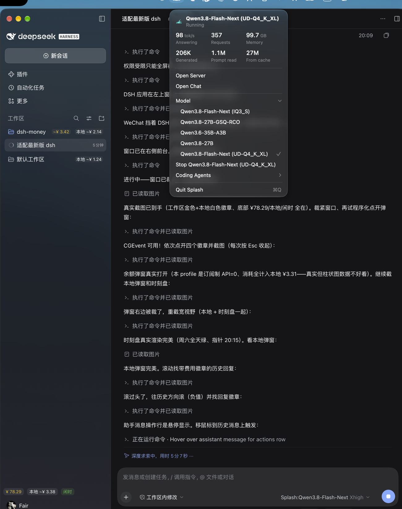
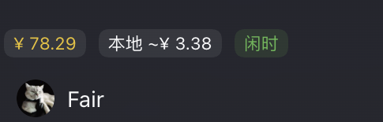
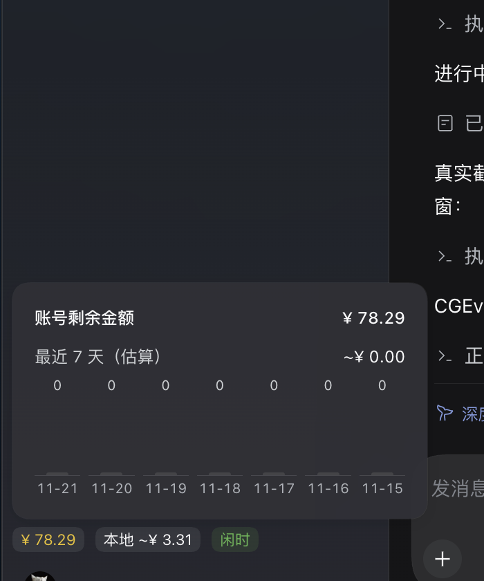
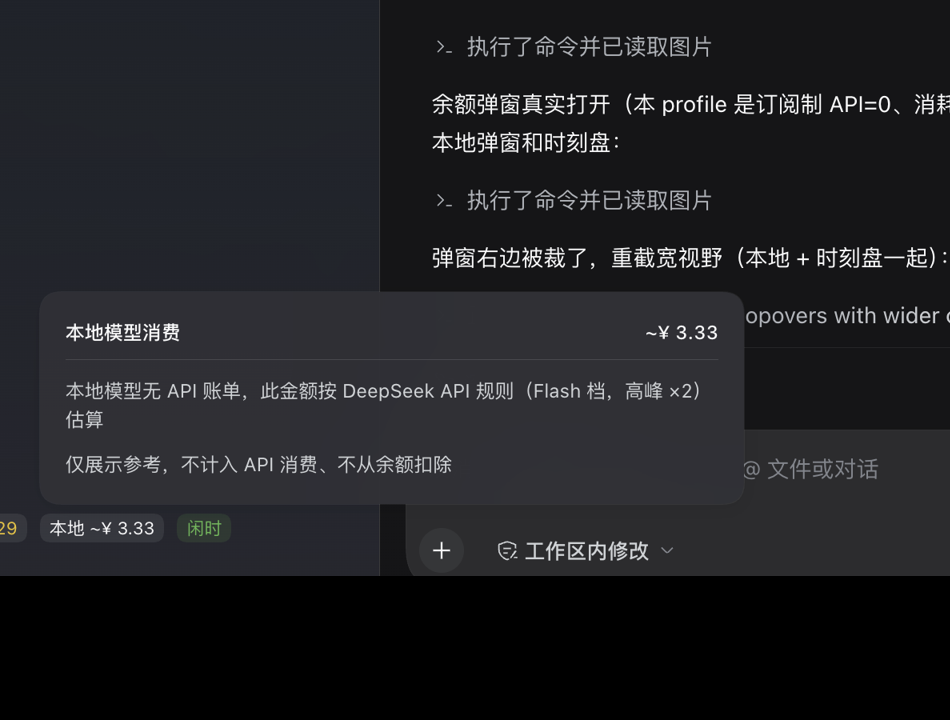
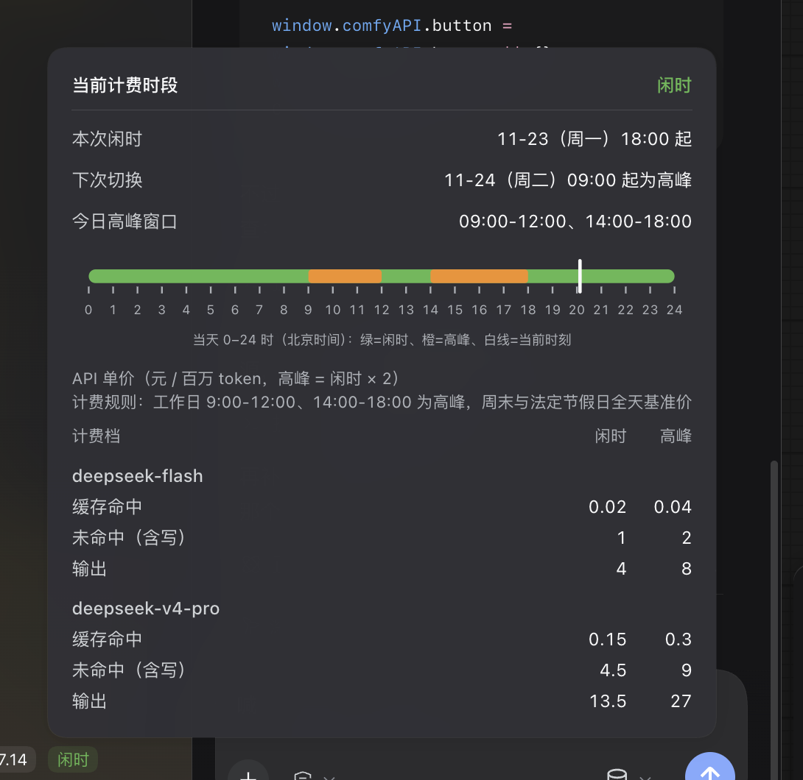
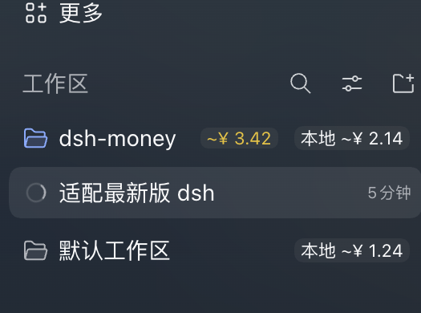
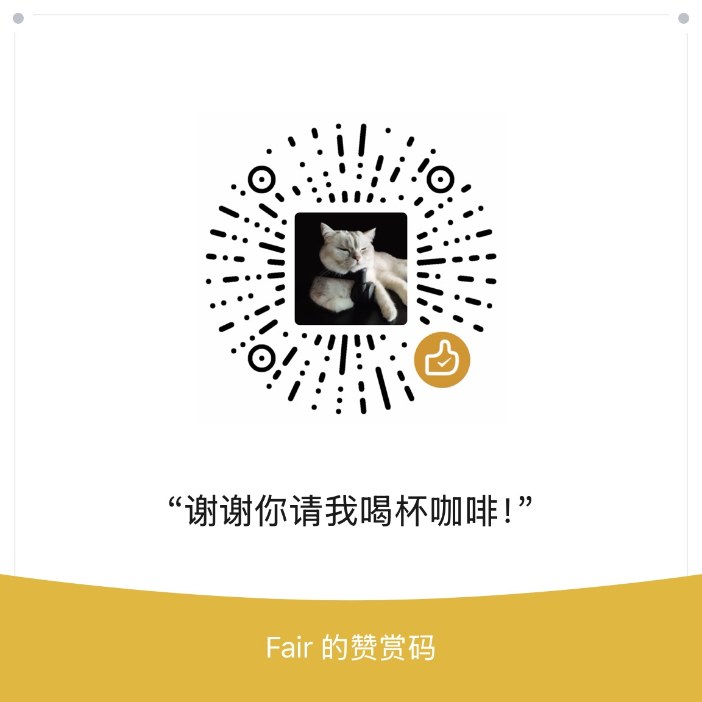

# dsh-money

> **DeepSeek Harness 费用追踪插件** —— 在界面各处实时显示账号余额、当前时段、对话 / 工作区 / 每次回复的费用，以及本地模型的模拟消费。金额用金色徽章（`#f0c11d`），本地模型消费用白色徽章，估算金额一律带 `~` 前缀。

  

## 一览



插件在 DSH 界面的四个位置挂载费用信息，**每一处徽章都可以点击**弹出细节卡片（外观与原生「用量 / 会话统计」弹窗一致）：

| 位置 | 显示 |
|---|---|
| **侧边栏底部** | 账号余额（金色）+ 本地模型消费（白色）+ 高峰 / 闲时时段徽章 |
| **侧边栏工作区行** | 该工作区全部会话的 API 费用（金色）+ 本地模型模拟消费（白色） |
| **输入框下方** | `本对话` 累计 API 费用 + 本地模拟费用两枚独立徽章 |
| **每条 AI 回复** | 该次回复的费用标签（本地模型为白色「本地」徽章） |

### 侧边栏：余额、本地消费、时段

三个徽章并排放在侧边栏底部（设置按钮旁）。折叠成图标栏时只显示币种符号。



- **余额**（金色，徽章显示「余额 ¥xx.xx」）：登录账号优先读 Platform 余额（充值 + 赠送钱包合计），未登录回退 `DEEPSEEK_API_KEY`。60 秒自动刷新，是实际值不带 `~`
- **本地**（白色）：本地 / 未计价模型按 DeepSeek API 规则模拟出的消费合计。只是参考，**不计入 API 消费、不从余额扣除**；无本地消费时不显示。余额行的本地弹窗带**最近 7 天本地消费柱状图**（与余额弹窗同款）
- **高峰 / 闲时**：按官方口径实时判断当前计费时段，到切换点自动刷新；高峰徽章带**距闲时倒计时**（分钟，每分钟刷新，如 `高峰 97分`）

点击余额，看**最近 7 天消费柱状图**（金色柱按金额等比、零消费日为浅灰矮柱、上金额下日期，按北京时间自然日，估算）：



点击「本地」徽章，说明本地模拟消费的口径：



点击时段徽章：首行左「当前计费时段」右「高峰 / 闲时」（数值与徽章文字同色：橙 / 绿），接着是本次时段起止、下次切换与今日高峰窗口；主体是**当天 0–24 时横轴时间条**（每小时一个刻度与数字 0…24、绿轨=闲时、橙段=高峰窗口、竖线=当前时刻（颜色随计费状态：高峰橙 / 闲时绿）；颜色与徽章文字同色 `#3fb950` / `#ff8f1f`）；底部以 **API 价目表**收尾——按模型分组列缓存命中 / 未命中 / 输出三档，闲时、高峰两列对照（当前币种，高峰 = 闲时 ×2），计费规则以灰色注释注明口径：



### 工作区行：每个项目的费用

侧边栏每个工作区名右侧显示该项目的费用总和。API 费用是金色徽章，本地模型模拟消费是白色徽章，两者分列不混算：



点击徽章弹出该工作区的总额、高峰 / 闲时分项与会话数。

### 输入框下方 + 每条回复

- **本对话**：`本对话 [~¥ 8.72]` 金色合计徽章；本地模型产生的费用以独立的白色「本地」徽章显示在右侧。30 秒自动刷新。点击弹出高峰 / 闲时分别合计（含条数）
- **每条回复**：该次回复的金色费用标签在其操作按钮行内（点击看模型、计价时段、token 用量）；本地模型的回复显示白色「本地」标签，弹窗同样显示**计价时段（高峰 / 闲时）**与**带 token 实数的计算公式**（高峰 ×2 直接演算）

### 弹窗交互

所有细节由插件自绘浮层渲染，**外观与原生「用量 / 缓存 / 会话统计」弹窗一致**（`--dsw-specific-menu` 菜单表面 + 毛玻璃、16px 圆角、`elevation-prominent` 描边阴影、12px/18px 字号、左灰标签右白色数值）。**宽度随内容自适应**（上限 600px，小屏按视口收缩），公式、价目数字、金额一律不拦腰折断——只在 `+` 号等自然断点换行。点击徽章弹出，再次点击、点别处或按 Esc 收起；滚动 / 缩放跟随重定位；文字可选中复制；支持键盘（Enter / 空格）。

## 兼容性

| dsh-money | DeepSeek Harness |
|---|---|
| **1.6.x** | **0.2.x**（当前适配 `0.2.2-rc.5`，`engines.dsh: ^0.2.1-rc.5`） |
| 1.4.x | 0.2.x（0.2.2-rc.5，点击弹窗） |
| 1.3.x | 0.2.x（0.2.1-rc.5 起） |
| 1.2.x | 0.2.x（基础适配） |
| ≤ 1.1.9 | 0.1.x |

## 计价口径

基于 [DeepSeek 官方价格页](https://api-docs.deepseek.com/zh-cn/quick_start/pricing)（**更新：2026-11**）。价格表在 `packages/dsh-money/src/index.ts` 的 `PRICES`，官方调价时同步更新并升版本。单位：每百万 token。

| 模型 | 币种 | 缓存命中（闲时） | 未命中（闲时） | 输出（闲时） |
|---|---|---|---|---|
| deepseek-flash | ¥ / $ | 0.02 / 0.003 | 1 / 0.15 | 4 / 0.6 |
| deepseek-v4-pro | ¥ / $ | 0.15 / 0.022 | 4.5 / 0.66 | 13.5 / 1.98 |

- **高峰翻倍**：北京时间**周一至周五 9:00-12:00、14:00-18:00**（UTC 01:00-04:00、06:00-10:00）三档价 ×2，其余为基准价。周末全天闲时
- **法定节假日**：中国法定节假日全天闲时；调休上班的周末仍算闲时。内置 2026 年[放假安排](https://www.gov.cn/zhengce/content/202511/content_7047090.htm)，新年度通知发布后更新 `CN_HOLIDAY_RANGES`
- **账单口径**：`未命中输入（含 cache write）× miss 价 + 缓存命中 × hit 价 + 输出 × out 价`（÷ 1,000,000）
- **本地模型**：不在价目表的模型（如 Ollama）**按 DeepSeek API 规则（Flash 档、高峰 ×2）估算**，显示在白色「本地」徽章，独立记账，不进 API 总额 / 高峰闲时分项 / 7 天柱状图，也不从余额扣
- **模型别名**：旧名 `deepseek-v4-flash`、`deepseek-v4-flash-vision-exp` 按 `deepseek-flash` 计价

> ⚠️ 所有 `~` 金额为基于官方公开价目的**估算**，不代表供应商最终账单。

### 计算示例（deepseek-flash 闲时，CNY）

```
usage: input 736 / cacheRead 492,928 / output 816
费用 = 736×¥1/M + 492,928×¥0.02/M + 816×¥4/M
     = ¥0.01385856（计算保留 8 位；界面显示 ~¥ 0.01）
```

## 显示约定

- **金色** `#f0c11d` = API 计费金额；**白色** = 本地模型模拟消费；均圆角徽章风格
- **计算 8 位、显示 2 位**：费用内部计算（单条、合计、7 天分桶）保留小数点后 **8 位**精度；界面上所有金额统一显示 **2 位**小数
- **`~` 前缀** = 估算（基于价目 × token）；余额为实际值，不加 `~`
- **`¥` 与数字间有空格**（`¥ 110.00`），美元 `$` 不带
- **token 带单位**（`1.2K token`、`328 token`）；费用行注明 `（元，估算）`

## 安装

> `1.2.0` 起本包是标准 DSH bundle（包内自带 `cordis.patch.yml`），安装即挂载，**不需要**手写 profile 补丁。

### 前置条件

- DeepSeek Harness **0.2.x**（Desktop 或 Web）
- 已登录 DeepSeek 账号，或配置了 `DEEPSEEK_API_KEY`（否则余额显示 `—`，费用仍正常计算）

### 方式 A：Plugins 页面 / 官方命令（推荐）

```bash
dsh plugin --profile <profile> add dsh-money
```

- Web 端 profile 通常是 `web`；**Desktop 的 profile 由应用管理**，用应用内 **Plugins 页面**安装（侧边栏「插件」→ 添加 → `dsh-money`）
- 安装后刷新页面即见徽章；升级用 `dsh plugin --profile <profile> update dsh-money` 然后重启 DSH

> ⚠️ 从 1.1.x 升级：先删掉 profile `cordis.patch.yml` 里手写的 `- id: money` 行，避免与包内补丁重复。

### 方式 B：手动安装

```bash
cd ~/.dsh/profiles/<profile>
npm i dsh-money
```

再在该目录 `cordis.patch.yml` 顶层追加：

```yaml
- insert:
    - id: money
      name: 'dsh-money'
```

重启 DSH 并刷新页面。方式 A、B **二选一**。

### 验证

侧边栏底部出现金色余额徽章、工作区行出现费用徽章、输入框下方出现 `本对话 ~¥ xx.xx`、AI 回复行内出现费用标签——任一项出现即安装成功。全无显示见「故障排查」。

## 使用

| 位置 | 内容 | 刷新 |
|---|---|---|
| 侧边栏底部 | 余额 + 本地消费 + 高峰/闲时徽章 | 60 秒 + 时段切换点 |
| 侧边栏工作区行 | 工作区 API 费用 + 本地消费 | 60 秒 + DOM 变化 |
| 输入框下方 | 本对话 API 合计 + 本地消费 | 30 秒 |
| 每条回复 | 该次回复费用 | 新回复时 |

### 切换显示币种

设置页 → **General**：

- **费用显示货币**：`自动（跟随余额）` / `人民币 ¥` / `美元 $`。启动时从本地恢复并推送 host，**重启后保持**（1.8.0 起）。
- **显示账号余额**：开关侧边栏底部的余额、本地消费与高峰/闲时徽章行（1.8.0 起，灵感来自 PR #2）；对话与回复处的费用标签不受影响。

两项设置持久化在浏览器 localStorage（`dsh-money.*`），DSH 重启不丢失。

## 更新

```bash
dsh plugin --profile web update dsh-money   # Desktop 用 Plugins 页面
```

然后**重启 DSH**（host 插件代码才换新）。bundle 补丁随包更新，profile 无需改动。

> **pnpm 提示**：pnpm 默认 `minimumReleaseAge` 会延迟安装新版本（防供应链投毒）。若提示 "Already up to date" 但 npm 已有新版属正常，等发布期过或用 `npm update` 绕过。

## 卸载

1. Plugins 页面移除 `dsh-money`（或 `dsh plugin --profile <profile> remove dsh-money`）
2. 重启 DSH
3. 手动安装者：删 `cordis.patch.yml` 里的 `- id: money` 行后重启

## 故障排查

| 现象 | 处理 |
|---|---|
| 安装被拒 `incompatible with dsh 0.2.x` | 装的是 1.1.x 旧版，升级到 **≥1.2.0** |
| `result codec has no create() factory` | 1.1.x 的 typert 产物不兼容 0.2.x，升级到 **≥1.2.0** 并重启 |
| 页面无费用显示 | ① Plugins 页面确认已启用；② 刷新页面（client bundle 需重载）；③ 手动安装确认 `name: 'dsh-money'` 拼写 |
| 余额显示 `—` | 未登录且无 `DEEPSEEK_API_KEY`，或网络不可达；费用计算不受影响 |
| 工作区行没有费用徽章 | 该项目还没有已计费会话；或侧边栏在搜索/过滤态 |
| 币种重启后变回"自动" | 进程内设置，预期行为 |
| 节假日仍按高峰计价 | 新年度放假安排未加入 `CN_HOLIDAY_RANGES`，补齐后重新构建 |
| 点击徽章无反应 | 升级后刷新页面；1.4.0 起为点击弹出 |
| 时段徽章停在旧状态 | 切换点后 1 秒内刷新；休眠跨点则 60 秒轮询纠正 |
| 升级 1.2.0 后报重复 id | 删掉 profile `cordis.patch.yml` 里手写的 `- id: money` 行 |

## 开发

```bash
git clone https://github.com/yanhuifair/dsh-money.git
cd dsh-money && npm install && npm run build   # 生成 lib/（typert 产物 + host + client bundle）
```

插件源码结构（monorepo）：

```
packages/dsh-money/
├── src/
│   ├── index.ts          # Host 半段：MoneyCostService（TypertRemoteService + @Remote）
│   ├── types.ts          # Remote 边界类型
│   ├── client.ts         # Client 半段类型入口
│   ├── client.entry.js   # Client 打包入口（esbuild 聚合 TYPERT_REMOTE + UI）
│   └── client.static.cjs # Client UI 实现（slot 注册 + 工作区行 DOM 注入 + 自绘弹窗）
├── cordis.patch.yml      # bundle 补丁
├── lib/                  # 构建产物
└── package.json          # dsh.bundle / dsh.client 声明
packages/typert-protocol/ # @deepseek-ai/dsh-typert-protocol 类型副本（供代码生成器识别）
```

时段判定：`index.ts` 的 `CN_HOLIDAY_RANGES`（每年更新）与 `isPeak()` / `periodStart()` / `nextPeriodChange()`；客户端只展示 host 返回的 `period`。

构建要求：`zod` 必须 **v4**；`@deepseek-ai/dsh-*` dev 依赖与目标 DSH 版本一致（当前 `0.2.2-rc.5`）。升级 DSH 后同步 `packages/typert-protocol/`。

## 版本历史

近期主要变更（完整历史见 [CHANGELOG 归档](#历史详情)）：

- **1.7.7** 弹窗宽度自适应放宽（440→600px 上限）；数字、公式、价目不拦腰折断，只在自然断点换行
- **1.7.6** 修复重启 DSH 后「本地总花费」徽章短暂消失：工作区费用表首拉失败（remote 未就绪/`ok:false`）时按 2/4/6…秒退避重试（最多 5 次），余额徽章挂载时也会主动催载一次
- **1.7.5** 每条回复的「本地」弹窗同样显示**计算公式**：该条 token 实数代入 Flash 单价（高峰 ×2）直接演算出金额
- **1.7.4** 本对话「本地」徽章弹窗显示**计算公式**：token 总量按闲时/高峰分组代入 Flash 单价，逐组列出带实数公式与约等结果（如 `闲时 1 条: (2.0M×1 + 492.9K×0.02 + 1.0M×4) ÷ 1M ≈ ~¥ 6.01`）
- **1.7.3** 其余弹窗排版统一：标题去「（估算）」等冗缀（左标签右数值），底部统一灰色注释行（币种 + 估算口径），回复弹窗省略 0 值 token 行，
余额/工作区弹窗补刷新与统计口径说明
- **1.9.5** 当前时刻线去掉深色垫线，保持纯色细线
- **1.9.4** 时段弹窗时间条的**当前时刻线颜色与计费状态一致**（高峰橙 / 闲时绿）
- **1.9.3** 消费柱状图改为**时间轴左旧右新**（最左=6 天前，最右=今天），余额与本地两张图一致
- **1.9.2** 高峰徽章倒计时格式改为「xx小时xx分钟」（如 `高峰 1小时38分钟`；不足 1 小时只显示分钟，整小时不带 0 分钟）
- **1.9.1** 余额行「本地」弹窗新增**最近 7 天本地消费柱状图**（host 新增 simDays 按天聚合，与余额 7 天图同款样式，标题「最近 7 天本地（估算）」）
- **1.9.0** 时刻盘改为 **0–24 时横轴时间条**：每小时一个刻度与数字，绿轨闲时 / 橙段高峰 / 白线当前时刻，比钟面更直观
- **1.8.3** 余额徽章文字带「余额」前缀（`余额 ¥78.25`），与「本地」「高峰」徽章风格一致；56px 折叠态仍只显示币种符号
- **1.8.2** 本地模型的回复弹窗也显示「计价时段：高峰（单价 ×2）/ 闲时（基准价）」，与 API 回复一致
- **1.8.1** 高峰徽章文字后加「距闲时」分钟倒计时（`高峰 97分`），每分钟自动刷新
- **1.8.0** 新增设置「显示账号余额」开关（隐藏侧边栏底部余额/本地/峰谷徽章行）；费用显示货币改为 localStorage 持久化，重启后不再回落「自动」（吸收 PR #2 的开关功能，持久化改用客户端方案）
- **1.7.9** 时刻盘配色与徽章统一：闲时绿 `#3fb950`、高峰橙 `#ff8f1f`（原带透明度显得偏淡）
- **1.7.8** 时段弹窗的「高峰 / 闲时」数值与徽章文字同色（橙 `#ff8f1f` / 绿 `#3fb950`）
- **1.7.2** 高峰/闲时弹窗排版优化：标题瘦身为「当前计费时段：高峰/闲时」（左标签右数值），时刻盘上移作主体，价目表按模型分组收尾，计费规则收进灰色注释行
- **1.7.1** 高峰/闲时弹窗新增 **API 价目表**：两个模型 × 三档单价，闲时/高峰两列对照（当前显示币种，每百万 token）
- **1.7.0** 金额口径统一：内部计算精确到小数点后 **8 位**，界面显示一律 **2 位**小数；时刻盘改为标准钟面（1-12 每小时一个刻度与数字）
- **1.6.3** 徽章文案「模拟」统一改为「**本地**」，弹窗注明无 API 账单按规则估算
- **1.6.2** 本地模拟改为**独立白字徽章**，与金色 API 徽章并排（回复 / 对话 / 工作区 / 余额四处），各点各的弹窗，互不混算
- **1.6.1** 本地模拟改为**完全按 DeepSeek API 规则计价**（Flash 档 + 高峰 ×2）；余额右侧新增白色「本地」徽章
- **1.6.0** **本地模型模拟费用**：价目表外模型按规则估算并显示，但不进 API 消费与余额
- **1.5.6** 时刻盘刻度改按 **24 小时制标注**（12 正午 / 15 / 18 / 21）
- **1.5.4** 时刻盘改为 **12 小时制钟面**（12 在上、3-6-9 刻度）
- **1.5.3** 时刻盘改用 **SVG 实心饼**，保证正圆
- **1.5.2** 时段徽章新增**当天时刻盘**（饼图，指针指向当前时刻）
- **1.5.1** 最近 7 天消费改为**柱状图**
- **1.5.0** 余额弹窗新增**最近 7 天消费**（北京时间自然日）
- **1.4.2** 弹窗样式与**原生「用量/缓存」点击弹窗**同款
- **1.4.0** 适配 DSH `0.2.2-rc.5`；细节从悬停改为**点击弹出**
- **1.3.0** 新增**高峰 / 闲时**区分（官方时段 + 法定节假日）
- **1.2.0** 适配 DSH **0.2.x**（标准 bundle、`deepseekAccount` 服务、2026-11 价目）

### 历史详情

<details>
<summary>1.4.2 及更早的详细变更</summary>

- **1.4.1** 细节卡片改用原生 Tooltip 样式（后被 1.4.2 取代）
- **1.3.5** 为 npm 包补充 `packages/dsh-money/README.md`
- **1.3.4** 输入框下方只保留「本对话」合计徽章
- **1.3.3** 时段悬停显示 `MM-DD（周X）HH:MM` 详细时间
- **1.3.2** 桌面窗口不渲染原生 `title`，改自绘浮层
- **1.3.1** 悬停明细给出高峰/闲时分项（含条数）
- **1.3.0** 高峰/闲时判定按官方口径，内置 2026 年放假安排
- **1.2.0** 标准 bundle 安装、`ctx.deepseekAccount`、2026-11 官方价目、官方 `sidebar.footer.action` 槽位、typert 产物用 0.2.1 生成器重生成

</details>

## 许可证

[GNU Affero General Public License v3.0](LICENSE) © yanhuifair

AGPL-3.0 是强 copyleft 协议：可自由使用、修改、分发，但衍生版本必须同样以 AGPL-3.0 开源并保留版权声明。

## 微信打赏

真的很需要大家的支持和鼓励


