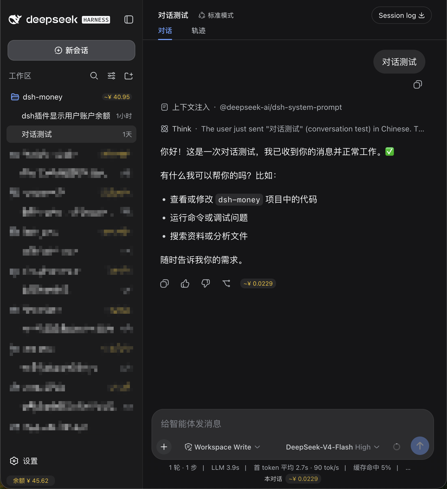

# dsh-money

DeepSeek Harness（DSH）费用追踪插件：在侧边栏显示账号余额与高峰/闲时徽章、在每个工作区行显示总费用、在输入框下方显示本对话费用、在每条回复旁显示该条费用，全部金额为金色徽章，估算值带 `~`。

## 兼容性

| dsh-money | DeepSeek Harness |
|---|---|
| **1.3.x** | **0.2.x**（当前适配 `0.2.1-rc.5`） |
| 1.2.x | 0.2.x（基础适配） |
| ≤ 1.1.9 | 0.1.x |

## 安装

- **Web**：`dsh plugin --profile web add dsh-money`，或在 Plugins 页面添加 `dsh-money`
- **Desktop**：应用内 **Plugins 页面** → 添加 → 输入 `dsh-money`（Desktop 的 profile 由应用管理，不能用 CLI）
- 包内自带 bundle 补丁（`cordis.patch.yml`），安装即挂载，**不需要**手写 profile 补丁
- 从 1.1.x 升级：先删掉 profile `cordis.patch.yml` 里手写的 `- id: money` 行，避免重复

## 显示内容

| 位置 | 内容 |
|---|---|
| 侧边栏底部（设置按钮旁） | 账号余额 + `高峰` / `闲时` 徽章（悬停看规则与下次切换时间） |
| 侧边栏每个工作区行 | 该工作区全部会话的费用合计 |
| 输入框下方 | 本对话累计费用（悬停看高峰/闲时分别合计与条数） |
| 每条回复的操作按钮行 | 该次回复费用（悬停看模型、计价时段、token 明细） |
| 设置 → General | 显示币种：自动 / 人民币 ¥ / 美元 $ |

余额优先取 DSH 登录账号的 Platform 余额（充值 + 赠送），未登录时回退 `DEEPSEEK_API_KEY` 的 `GET /user/balance`。

## 计价口径（2026-11 官方价目）

每百万 token，空闲时段；高峰 = ×2：

| 模型 | 缓存命中 | 未命中 | 输出 |
|---|---|---|---|
| deepseek-flash | ¥0.02 / $0.003 | ¥1 / $0.15 | ¥4 / $0.6 |
| deepseek-v4-pro | ¥0.15 / $0.022 | ¥4.5 / $0.66 | ¥13.5 / $1.98 |

- 高峰时段：北京时间**周一至周五** 9:00-12:00、14:00-18:00，**排除中国法定节假日**（内置 2026 年放假安排）
- 旧模型名 `deepseek-v4-flash` 按 Flash 计费；不在价目表中的模型（如本地 Ollama）不显示费用
- 费用为按官方公开价目估算，不代表最终账单

## 文档

完整说明（安装/更新/卸载、故障排查、计价细节、开发）：<https://github.com/yanhuifair/dsh-money#readme>

## 许可证

[AGPL-3.0](https://github.com/yanhuifair/dsh-money/blob/main/LICENSE) © yanhuifair
