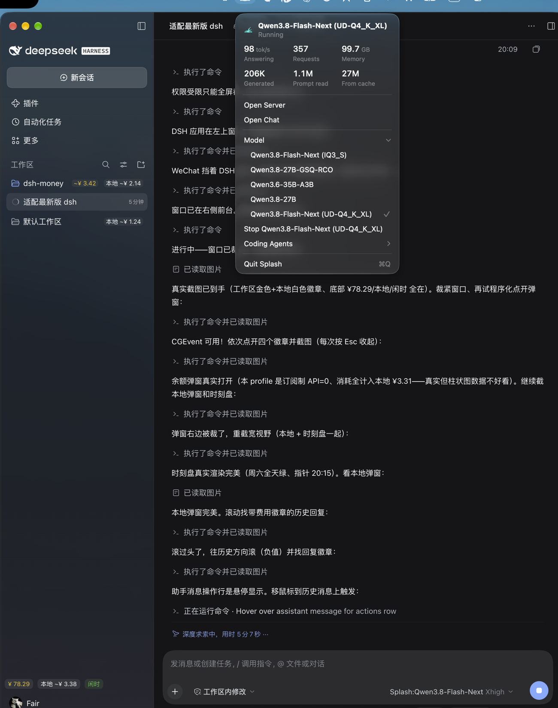
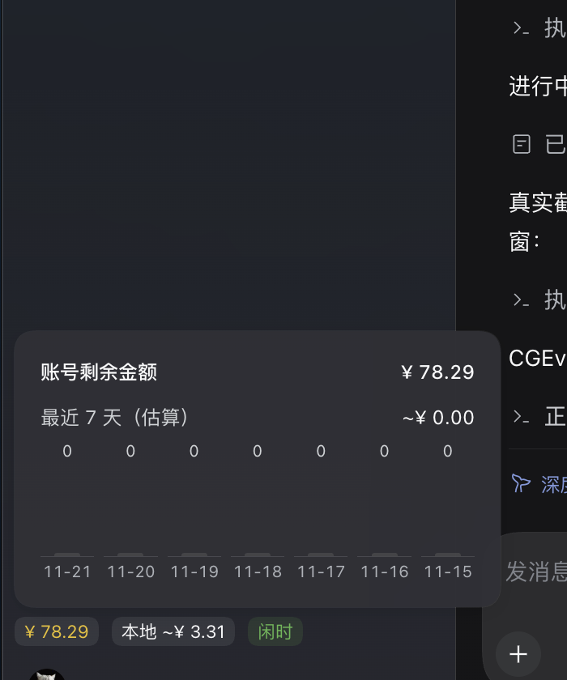
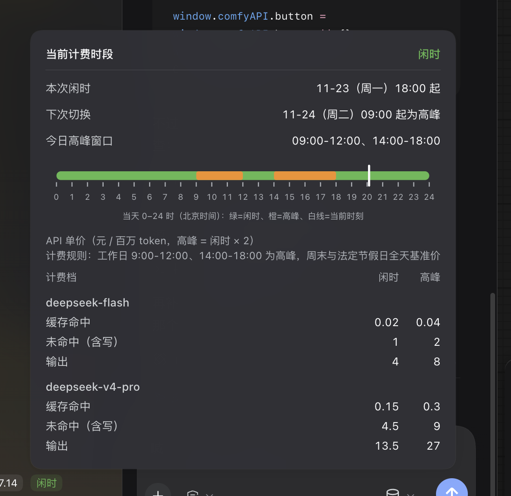
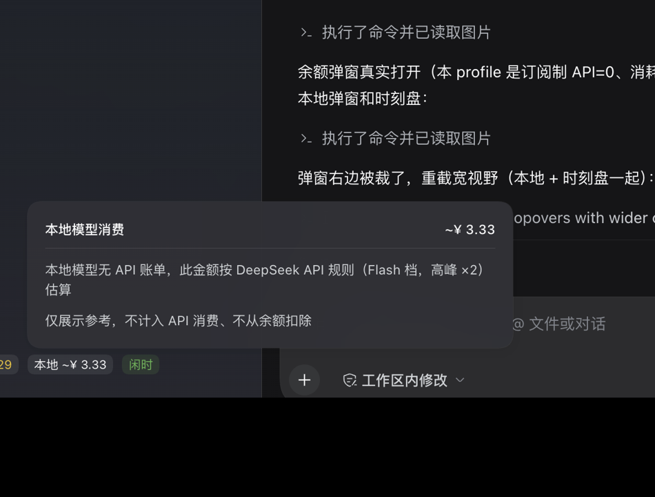

# dsh-money

**DeepSeek Harness 费用追踪插件** —— 在 DSH 界面各处实时显示账号余额、当前计费时段、对话 / 工作区 / 每次回复的费用，以及本地模型的模拟消费。API 金额用金色徽章、本地模拟用白色徽章，估算金额带 `~` 前缀；每一处徽章点击都弹出与原生一致风格的细节卡片。



## 功能

- **侧边栏底部**：账号余额（金色，登录账号 / API Key 自动选择，60 秒刷新）+ 本地模型消费（白色）+ `高峰`/`闲时` 时段徽章
- **余额弹窗**：余额明细 + **最近 7 天消费柱状图**（北京时间自然日，估算）
- **时段弹窗**：官方规则、本次时段起止、下次切换时间 + **当天 12 小时制时刻盘**（绿=闲时、橙=高峰扇区、白针=当前时刻）
- **工作区行**：项目 API 费用（金色）+ 本地模型消费（白色），点击看高峰 / 闲时分项与会话数
- **输入框下方**：`本对话` 累计费用 + 独立「本地」徽章
- **每条回复**：操作行内的费用标签（点击看模型、计价时段、token 明细）
- **本地模型**（Ollama 等价目表外模型）：按 DeepSeek API 规则（Flash 档、高峰 ×2）**估算**并独立显示，不进 API 消费、7 天柱状图与余额

  

## 安装（DSH 0.2.x）

Desktop：侧边栏「插件」→ 添加 → `dsh-money`。命令行：

```bash
dsh plugin --profile <profile> add dsh-money
```

标准 bundle，安装即挂载；刷新页面生效，升级后重启 DSH。

## 计价口径

[DeepSeek 官方价目](https://api-docs.deepseek.com/zh-cn/quick_start/pricing)（2026-11）；高峰 = 北京时间周一至周五 9:00-12:00、14:00-18:00（法定节假日除外），三档价 ×2。费用为公开价目 × token 用量的**估算**（带 `~`），不代表供应商账单。

完整文档（弹窗交互、币种设置、故障排查、开发者说明）：[github.com/yanhuifair/dsh-money](https://github.com/yanhuifair/dsh-money#readme)

## License

AGPL-3.0 © yanhuifair
